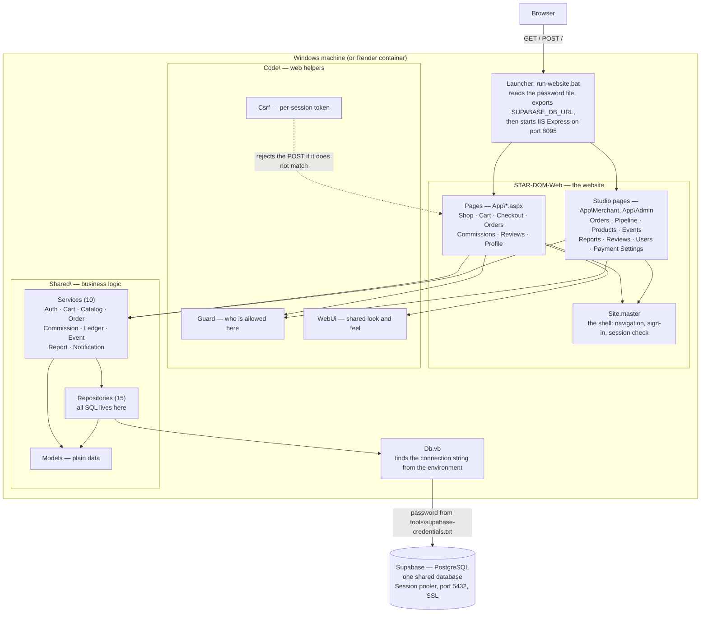
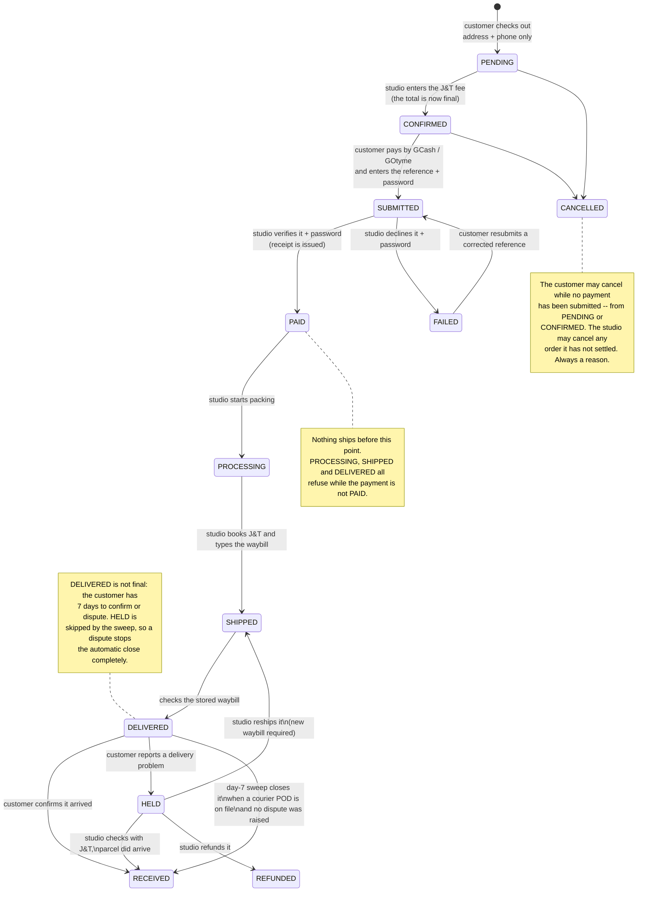

# Architecture — STAR:DOM

## What this is, in one paragraph

STAR:DOM is a single ASP.NET Web Forms website written in VB.NET, talking to one
PostgreSQL database hosted on Supabase. There is no separate frontend build, no
API layer, and no ORM. The browser receives plain HTML, one CSS file, and a
little vanilla JavaScript. Everything — the shop, the cart, the payment flow,
the admin console — is the same application, the same process, the same database.

---

## The one idea that explains the whole codebase

Every request travels the same road, and each layer is only allowed to talk to
the next one:

```
Browser  →  Page  →  Service  →  Repository  →  Database
```

| Layer | Job | Example |
|---|---|---|
| **Page** (`App\*.aspx.vb`) | Render HTML. Read what the user asked for. | "Show me the Orders page" |
| **Service** (`Shared\Services\`) | The business rules. *"An order cannot be cancelled once a payment reference has been submitted."* | "Cancel this order" |
| **Repository** (`Shared\Repositories\`) | All the SQL. Every query in the project lives here. | `UPDATE Orders SET ...` |
| **Model** (`Shared\Models\`) | Plain data shapes. No behaviour. | `Order`, `Commission`, `Product` |

Rendering runs the same road in reverse: a page builds HTML through
`Code\WebUi.vb`, so a card, table, badge or modal looks identical everywhere.

**The rule that keeps it maintainable:** a page never writes SQL, and a
repository never writes HTML. That one boundary is what stops a change in one
screen from rippling across the whole site.

---

## The full request path



---

## Where the data lives

**One database: Supabase.** Every machine — yours, your teammate's, the Render
server — reads and writes the same rows. There is no local database and no
per-machine copy, which means a demo behaves the same for everyone and two
people can never see different data.

The password cannot live in git, so each machine provides it once:

```
tools\supabase-credentials.txt   ← git-ignored, written by setup.bat
        ↓
run-website.bat reads it, exports SUPABASE_DB_URL
        ↓
IIS Express inherits the variable
        ↓
Code\Db.vb builds the connection from it
```

`Db.vb` tries, in order:

1. `SUPABASE_DB_URL` (the whole connection URI)
2. `DB_HOST` + `DB_USER` + `DB_PASSWORD`, etc.
3. a `STAR_DOM` connection string in `web.config` — **absent on purpose**

If none of those is set, the app says exactly what is missing and points at
`setup.bat`. It does **not** guess a host and fail with a confusing error.

`tools\pgsql` is committed (about 120 MB) but only as a **client** — the
`psql` command-line tool. `setup.bat`, `doctor.bat` and
`tools\reseed-supabase.bat` use it to test the connection and to reload the
schema. It is not a server and there is nothing to start.

---

## Layer rules

| Layer | May call | Must never |
|---|---|---|
| Pages | `Code\*`, `Shared\Services\*` | write SQL |
| `App\PaymentQr.aspx.vb` | the payment-settings repository | render HTML — it only streams bytes |
| Services | Repositories, Models | know that a web request exists |
| Repositories | Models, `Code\Db.vb` | build HTML or hold business rules |
| Models | nothing | carry behaviour beyond validation |

Every query is parameterised through one helper, so there is no
string-concatenated SQL anywhere in the project.

---

## How an order travels

The important design choice: **there is no payment step at checkout.** The
customer cannot pay yet, because nobody knows the shipping cost. J&T charges
by weight, so the studio has to weigh and quote it first. Only after that is
there a final number to pay.



**The delivery window.** Days are counted from the J&T hand-off, not from the
status change: day 5-6 sends one reminder, and from day 7 a scheduled sweep may
close an order that has a courier proof of delivery on file and no dispute.
Anything else stays `DELIVERED` and is flagged to the studio instead. Nothing is
closed against a customer who was never told the parcel had landed.

**The studio's earning.** One ledger row per order, held from `DELIVERED`,
released when the order becomes `RECEIVED`, and voided by a refund — flagged as a
reversal (a clawback) when it had already been released. It records a decision;
the money itself moves outside the system.

**Why the payment takes two people.** The customer's submission only parks the
payment as `SUBMITTED`. Only the studio, behind a password, can make it `PAID`.
Neither side alone can complete a payment — which is exactly how a real store
should work.

---

## How a commission travels

Same two-person rule, plus a real production stage:

```
request (5 steps) → studio accepts and quotes a price → customer confirms
  → customer pays (channel + reference) → studio verifies → production starts
  → photos for review → any revisions → finalization
  → delivered with a J&T number → customer confirms receipt
```

Two things worth knowing: an artist's open-request **capacity is enforced** (a
customer cannot flood a queue), and a commission can only be marked delivered
once a tracking number is recorded.

---

## Two files worth knowing about

**`App\PaymentQr.aspx`** — the wallet QR images live inside the database
(`paymentsettings.qrimagedata`), not on disk. This page streams the bytes with
an `ETag`, answers `HEAD`, and returns a tiny transparent image when a channel
has no QR yet, so an `` never breaks. Because the images are in the
database, a backup or a new machine gets them for free.

**`Global.asax.vb`** — this is where the CSRF token is checked on every POST.
The pages build their own raw `<form>` markup rather than using server
controls, so the check cannot live in each page. One place means a new page
cannot forget it.

---

The repository-layout picture below is rendered by GitDiagram and refreshes
when the repo is pushed. The diagrams above are hand-written and always current.

[](https://gitdiagram.com/jamesmangao/stardom)