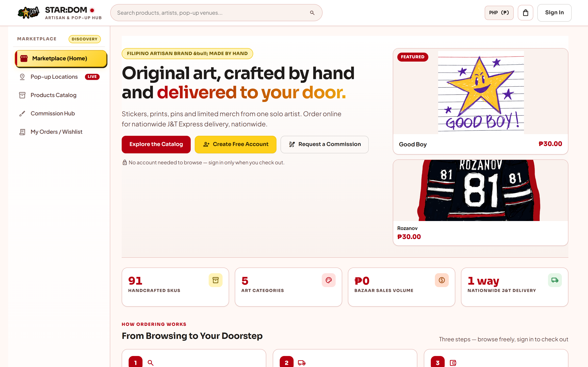
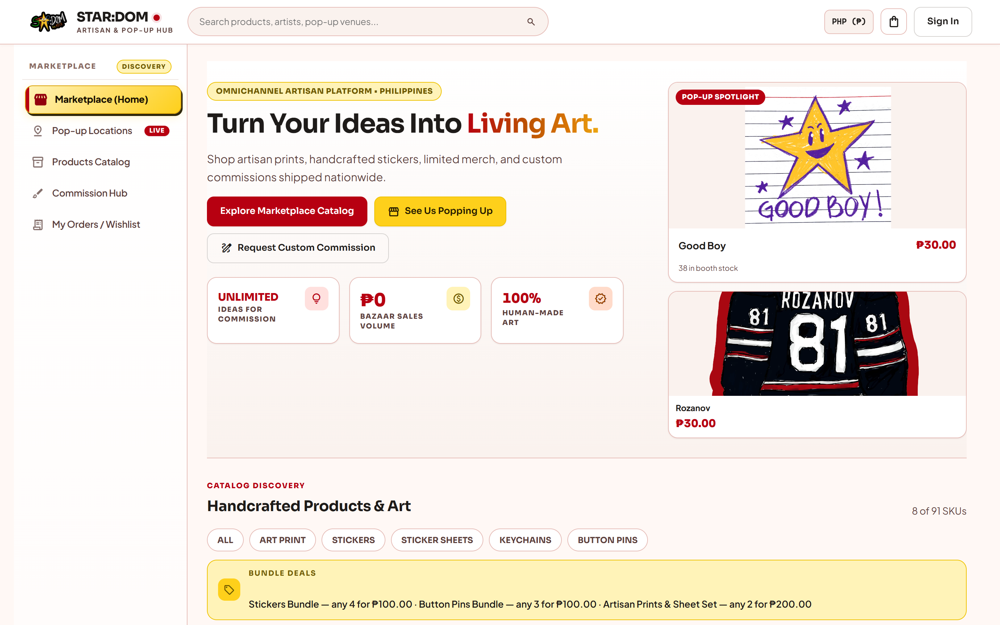
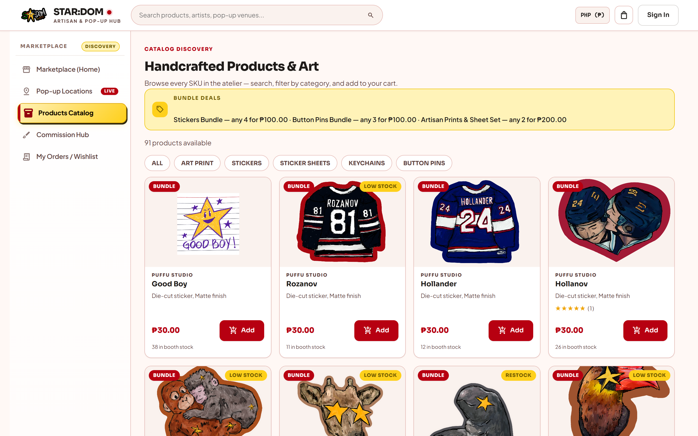
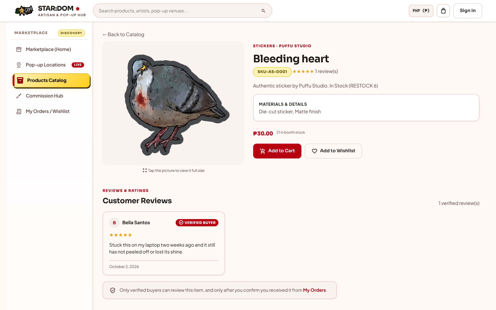
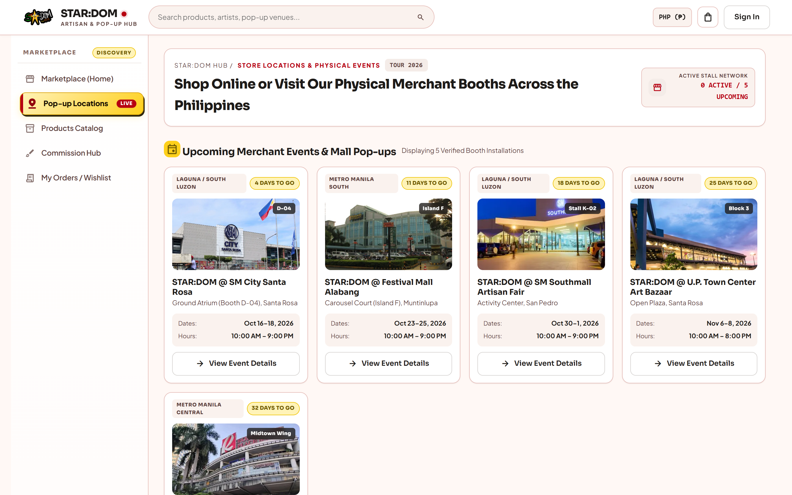
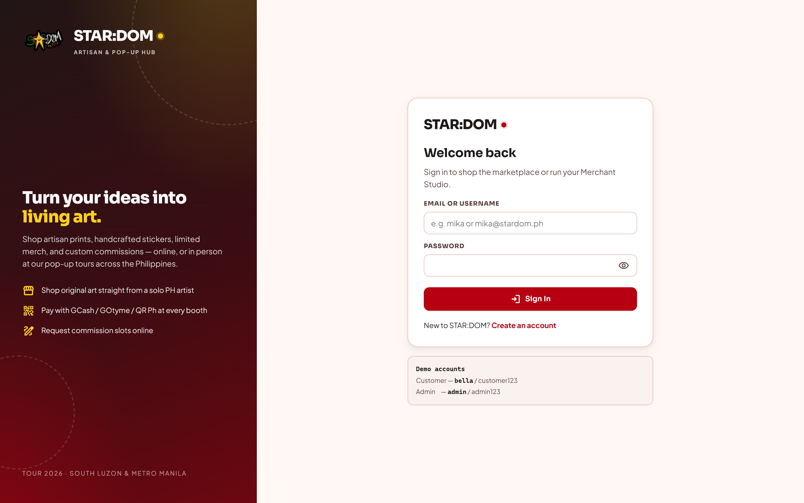
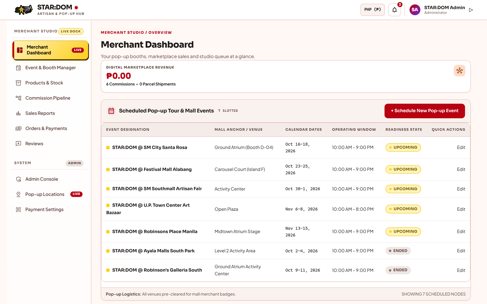
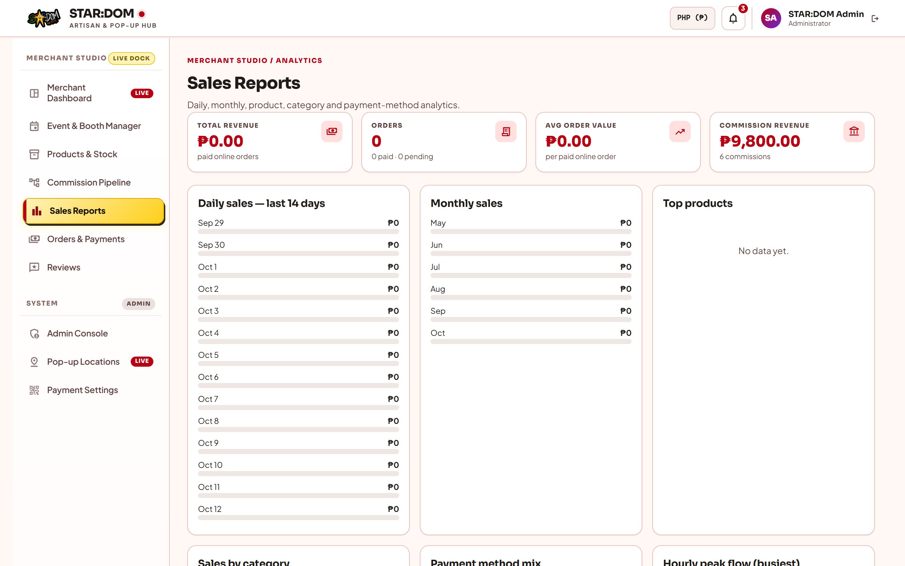
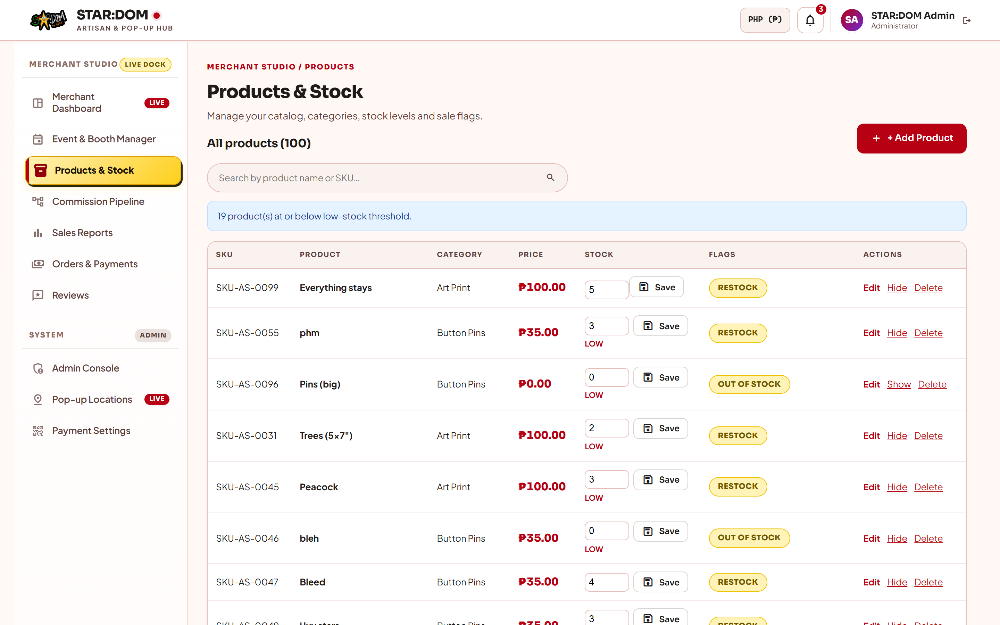
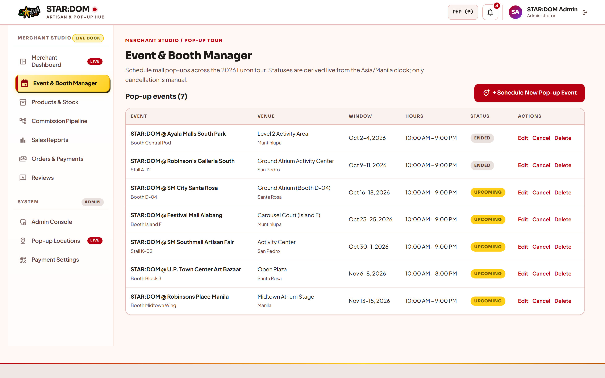

# STAR:DOM — Artisan & Pop-up Hub (Website)

An online marketplace for a pop-up artisan brand. Customers browse a
catalog of handmade goods and pay online by **GCash or GOtyme e-wallet** —
shipped nationwide via **J&T Express** (delivery only; no cash on delivery
and no pick-up). The studio quotes the real J&T shipping fee once an order
is placed, the customer pays the final total against that quote, and the
studio verifies the e-wallet reference before anything ships. Artists take
custom work through a commission pipeline, and the store owner runs
everything from a merchant studio.

**Repository:** github.com/JamesMangao/STAR-DOM

---

## Screenshots

Live captures from the running site — every frame is a real page rendered against
the shared Supabase data, not a mockup. Full-resolution PNGs (2880×1800) are in
[`docs/screenshots/`](docs/screenshots/).

### Storefront

| Home | Marketplace |
|---|---|
|  |  |
| Landing page — hero, live pop-up status, featured pieces, open commission slots | The browsable shop grid, commission slots and pop-up banner |
| **Products catalog** | **Product detail** |
|  |  |
| Full catalog with category filtering and search | One product — photos, description, stock, bundle deal |
| **Pop-up locations** | **Sign in** |
|  |  |
| Current pop-up hero, upcoming schedule, venue photos streamed from the database | Sign-in gate; demo accounts are printed on the page |

### Merchant Studio

| Dashboard | Sales reports |
|---|---|
|  |  |
| KPIs, current event, scheduled pop-up tour, low-stock alerts, recent sales | Revenue, order counts and product/category/payment analytics |

**The zeroes above are real, not a rendering fault.** The revenue KPIs read
`₱0.00` because no order has been placed against this database yet — orders and
payments are never seeded (see [What is real and what is seeded](#what-is-real-and-what-is-seeded)).
`COMMISSION REVENUE` shows `₱9,800` because commissions *are* seeded, and they
are a separate revenue stream that is deliberately excluded from
`TOTAL REVENUE`. The same is true of the empty charts.

| Products & stock | Event & booth manager |
|---|---|
|  |  |
| Add, edit, retire products; hand-adjusted stock | Pop-up schedule, booth numbers, venue photos |

> Pages are captured at 1440×900 and rendered at 2×. Regenerate with any
> screenshot tool after a visual change — the images are static files.

---

## The Website

This section describes the site as a **product** — what it looks like, what is on
it, and what each page is for. The engineering sections follow further down.

### The brand

STAR:DOM is a pop-up artisan brand. The visual language is warm, hand-made and
deliberately not corporate — it should feel like a booth at a weekend market,
not like a bank portal.

| | |
|---|---|
| **Primary** | Deep red `#b70011` — the brand colour, used for prices, CTAs and the logo |
| **Accent** | Warm yellow `#fed01b` — highlights, badges, the "LIVE" markers |
| **Surfaces** | Cream, not white: `#fff8f5` page, `#faf2ee` → `#eee7e3` raised panels, `#ffffff` cards |
| **Ink** | Near-black brown `#1e1b19`, softening to `#5c403c` and `#8a6a62` |
| **Type** | **Sora** 600/700/800 for headings, **Plus Jakarta Sans** 400–800 for body |
| **Icons** | Material Symbols Outlined — one outlined glyph per action, never emoji |

The palette, spacing, radius and motion all live as CSS custom properties in the
top of `css\site.css`, so changing the brand means editing tokens rather than
hunting through markup. `css\site.css` is the entire design system (~1,460
lines): cards, tables, badges, buttons, modals, the step rail, the toast
wrapper, toasts, skeleton states, and the responsive breakpoints down to phone
width.

### Who uses it

There are exactly **two roles**, and this is not negotiable — the whole site is
built on it.

- **CUSTOMER** — anyone who registers. Browses, buys, requests commissions.
- **ADMIN** — the store owner, who is *also* the artist. One account, so the
  person making the art is the person running the shop. Registration always
  creates a CUSTOMER; only the owner can promote anyone.

The customer-facing pages and the studio pages are therefore the *same* pages
with a different shell: signing in as `admin` swaps the storefront navigation
for the studio navigation.

### Every page on the site

33 pages. "Who" is who can see it — anonymous visitors get the storefront.

#### Storefront (anonymous)

| Page | URL | What it is |
|---|---|---|
| Home | `/` | The landing page — hero, live pop-up status, featured products, categories, stat strip, open commission slots |
| Pop-up Locations | `/App/PopupLocations.aspx` | Where the brand has been and will be: current pop-up as a hero, upcoming schedule, mall photos streamed from the database |
| Products Catalog | `/App/Catalog.aspx` | The full catalog with category filtering and search |
| Product | `/App/Product.aspx?id=` | One product: photos, description, stock, bundle deal, add to cart / save for later |
| Marketplace | `/App/Marketplace.aspx` | The browsable shop grid, open commission slot cards, pop-up banner |
| Sign in / Register | `/Login.aspx`, `/Register.aspx` | Both remember where you were, so you land back on the product you clicked |

#### Customer (signed in)

| Page | URL | What it is |
|---|---|---|
| Cart | `/App/Cart.aspx` | Line items, quantity, saved-for-later items, move between cart and wishlist |
| Checkout | `/App/Checkout.aspx` | Delivery address + contact phone only. **Place Order writes the order immediately** — there is no payment popup here, because the shipping fee is not known yet |
| My Orders / Wishlist | `/App/Orders.aspx` | Every order with live status, plus the wishlist, on one page |
| Order Detail | `/App/OrderDetail.aspx?id=` | The order timeline, items, receipt, tracking, Scan-to-Pay, and cancel-while-pending |
| Commission Hub | `/App/CommissionHub.aspx` | Your commission requests and the artists' open slots |
| Request a Commission | `/App/CommissionRequest.aspx` | A 5-step rail — describe the piece, reference, sizing, budget, delivery |
| Commission Detail | `/App/CommissionDetail.aspx?id=` | Offer, payment, production, review, delivery — the whole conversation with the studio |
| Notifications | `/App/Notifications.aspx` | Every alert, deep-linking to the exact order or commission it is about |
| Profile | `/App/Profile.aspx` | Name, email, phone, password, and saved delivery addresses |
| Receipt | `/App/Receipt.aspx` | BIR-style receipt with the VAT breakdown |

#### Studio + admin (`admin`)

| Page | URL | What it is |
|---|---|---|
| Merchant Dashboard | `/App/Merchant/Dashboard.aspx` | KPIs, revenue, current event, quick actions |
| Orders & Payments | `/App/Merchant/Orders.aspx` | Quote the J&T fee, verify or decline payments behind a password, book the waybill, move the order along |
| Commission Pipeline | `/App/Merchant/Pipeline.aspx` | Every request: accept and quote, decline, production, send for review, deliver |
| Products & Stock | `/App/Merchant/Products.aspx` | Add, edit, retire. Stock is adjusted by hand after physical booth sales |
| Event & Booth Manager | `/App/Merchant/Events.aspx`, `EventEdit.aspx` | Pop-up schedule, booth numbers, venue photos |
| Sales Reports | `/App/Merchant/Reports.aspx` | Online revenue: daily/monthly trend, top products, category and payment-method mix, hourly flow |
| Reviews | `/App/Merchant/Reviews.aspx` | Moderate what customers wrote |
| Admin Console | `/App/Admin/Users.aspx` | Users and roles |
| Pop-up Locations (admin) | `/App/Admin/AdminPopupLocations.aspx` | The same schedule as the storefront, with editing |
| Payment Settings | `/App/Admin/PaymentSettings.aspx` | QR images, account name and number, captions, per-channel enable, **and new channels** |

Two more are infrastructure and have no navigation: `/App/AssetImg.aspx`
streams venue photos out of the database, and `/App/PaymentQr.aspx` streams a
wallet's QR image.

### The two journeys

**Buying.** Browse → product → cart → checkout (address + phone, nothing else)
→ **Place Order**. The order is written right there in a single transaction, with
the shipping fee *not* yet included, because J&T only weighs the parcel later.
Then on **My Orders**:

1. The studio enters the J&T fee on the order. *That entry is the confirmation* —
   the order becomes `CONFIRMED` and the total is final.
2. The customer opens **Scan to Pay**, sees the admin's GCash or GOtyme QR,
   pays in their own wallet app, and submits the **reference number plus their
   password**. This only parks the payment as `SUBMITTED`.
3. The studio verifies it behind their own password. Confirm → `PAID` and the
   official receipt issues. Decline → `FAILED`, and the customer gets the
   support line to resubmit.

Nothing ships on an unverified payment: `PROCESSING`, `SHIPPED` and `DELIVERED`
all refuse until the payment is `PAID`, and `DELIVERED` checks the *stored*
waybill. Customers confirm arrival, which unlocks their review.

**Commissioning.** Request (5 steps) → the studio accepts and quotes a price and
completion date → the customer confirms → pays by the same two-step
verify-before-production rule, now recording **which** wallet they used → the
studio confirms and production starts automatically → photos for review → any
revisions → finalization → delivery with a mandatory J&T number → the customer
confirms receipt.

Each artist's queue has a **capacity** the site actually enforces — a new request
is refused once the artist is at their limit, so a queue cannot be flooded.

### Rules a customer can feel

- **You cannot cancel what is already moving.** An order can be cancelled by the
  customer only while it is still `PENDING` and unpaid. Once it is processing,
  paid or shipped, cancelling is a conversation with the studio, not a button.
- **Cancelling always asks why.** Orders and commissions both require a reason,
  and the studio sees it. A cancellation that silently vanishes helps nobody.
- **Cancelling is not a refund.** A cancelled order is marked `CANCELLED`, never
  `REFUNDED` — nothing was refunded, and a paid order keeps its `PAID` record.
- **A session cannot outlive your account.** Suspending a user or changing their
  role takes effect on their very next page load, not whenever they decide to
  log out.

## What this is

A single ASP.NET Web Forms application: one process, one .NET Framework
4.8 AppDomain, one PostgreSQL database. There is no API tier, no ORM and
no client-side framework — the browser receives HTML, a CSS
design system and a little vanilla JavaScript.

| | |
|---|---|
| **Language** | VB.NET |
| **Framework** | ASP.NET Web Forms, .NET Framework 4.8 |
| **Database** | PostgreSQL via Npgsql 8.0.9 — 30 tables, no ORM, parameterised SQL throughout |
| **Hosting** | IIS Express 10 locally, or Mono/XSP4 in a Docker image on Render |
| **Roles** | Only two: **ADMIN** (the store owner, who is also the artist) and **CUSTOMER** |
| **Payments** | GCash / GOtyme / any channel the owner adds, paid by QR against a studio-quoted J&T fee — no COD |
| **Fulfilment** | J&T Express nationwide (delivery only) |
| **Receipts** | BIR-style receipts with a VAT breakdown |
| **External services** | None required — no payment gateway API, no shipping API, no third-party auth |

### How a request flows

Browser → an `.aspx` page → its `.aspx.vb` code-behind →
`Shared\Services` → `Shared\Repositories` → `Code\Db.vb` → PostgreSQL.

Rendering runs the other way, through `Code\WebUi.vb`, which
centralises the design system so a card, table, badge or modal renders
identically wherever it appears.

Pages never talk to Npgsql directly, and repositories never build HTML.
That one rule is what stops a change rippling across the whole site.

## What you can do end-to-end

- **Customer:** browse/search the catalog (bundle deals shown and **applied
  automatically** — Stickers 4 for ₱100, Button pins 3 for ₱100), product
  detail, cart & checkout (delivery address + phone — the J&T fee is quoted
  after you order), place the order unpaid, then pay the **final** total once
  the studio has returned it, via **Scan-to-Pay QR** against any channel the
  owner has enabled (e-wallet reference number) behind a **password
  re-entry** — then track the parcel
  through the J&T status line + tracker link and confirm it arrived ("Confirm
  order received") to unlock reviews, pop-up locations & schedules,
  commission requests (5-step wizard; commissioned products are
  delivery-only), reviews, notifications, profile. A **wishlist** sits on the
  same page as the orders, and an order can be cancelled **only while it is
  still `PENDING` and unpaid** — and never without saying why.
- **Store owner (`admin`, or the legacy `mika`/`renzo`/`puffu` owner
  accounts):** dashboard KPIs, products & stock (stock is adjusted by hand —
  the site sells online only), event & booth manager, commission pipeline
  (accept + quote / decline / production), orders & payments:
  **confirm & quote** an order (entering the J&T fee IS the confirmation),
  book J&T with the tracking number, and **verify submitted payments** behind
  a **password re-entry** (confirm → PAID + official receipt, or decline →
  customer is handed the support line), sales reports showing **online
  revenue only — booth takings are no longer recorded, because a pop-up is a
  marketing presence rather than a till**, review moderation,
  Admin Console (users & roles), admin **Pop-up Locations**, and
  **Payment Settings**. A commission is only marked delivered once a **J&T
  tracking number** is recorded, so a finished piece always carries proof of
  the hand-off.
- **Admin:** the owner account IS the admin — STAR:DOM has exactly two roles:
  ADMIN (store owner, who is also the merchant/artist) and CUSTOMER. New
  registrations always become CUSTOMER; only the owner can manage accounts.

### Commission slots

The **Open Commission Slots** cards (Marketplace, home page, Commission Hub) are
generated from merchants who have `CommissionSlotCapacity > 0`, and each card
shows the artist name, turnaround, claim method and a link into the Hub. The
per-artist style tagline and the fixed formats list were removed as clutter:
the output is agreed per request, so a fixed list on the card was misleading.
`Users.CommissionTagline` and `Users.CommissionFormats` are still stored and
still editable — they are just not rendered on the card.

### What is real and what is seeded

All business data is read from and written to PostgreSQL through parameterised
`Npgsql` calls — there is no ORM and no string-built query anywhere. But be
clear about what is live and what is demonstration data:

| | |
|---|---|
| Cart, checkout, orders, payments, commissions, stock, reviews | **real** — real tables, real SQL, real writes |
| Products, users, events, booth inventory | seeded from `supabase_seed.sql` (100 products, 10 users, 7 events) |
| Wallet QR images | **real uploads**, stored in the database |
| Some dashboard KPI captions | **hardcoded sample text** — e.g. `All venues pre-cleared for mall merchant badges` |
| Orders & payments | **never seeded** — every order/payment row is written live. The shared Supabase currently holds a handful of demo rows from end-to-end verification (3 orders, 3 payments, 2 receipts at the time of writing) |

The revenue figures themselves *are* computed from `Orders` — every KPI on the
Sales Reports screen is a live aggregate over paid online orders, and
`EventSales` plays no part in it. It is the surrounding flavour text that is
illustrative.


## How the code is organised

```
<your clone folder>
├── setup.bat                     <- ★ run ONCE on a new machine
├── doctor.bat                    <- ★ diagnose a machine, changes nothing
├── run-website.bat               <- ★ run this to start the site
├── build.bat                     <- run after any code change
├── share-website.bat             <- share the site publicly via a Cloudflare tunnel
│                                    (cloudflared ships in tools\cloudflared\)
├── docs\screenshots\             <- README gallery: 2880x1800 PNG captures of the live site
├── STAR-DOM-Web.sln              <- open this in Visual Studio (optional)
├── Dockerfile / render.yaml      <- Render deploy (Mono + XSP4)
├── tools\                        <- PostgreSQL runtime (committed) + Supabase scripts
│   ├── BUILD_STATE.md            <- build/runtime notes for whoever is next
│   ├── supabase-env.bat          <- loads SUPABASE_DB_URL into the environment
│   ├── set-credentials.ps1       <- masked password prompt used by setup.bat
│   ├── reseed-supabase.bat       <- wipes + reloads Supabase from schema/seed
│   ├── generate_mall_images_sql.py <- rebuilds Database\mall_images.sql from Assets\Malls
│   ├── supabase-credentials.example.txt
│   ├── supabase\prod-ca-2021.crt <- Supabase root CA (must be installed)
│   └── pgsql\                    <- PostgreSQL server runtime (committed, fallback)
└── STAR-DOM-Web\                 <- the website (everything lives here)
    ├── STAR-DOM-Web.vbproj
    ├── web.config                <- localhost fallback connection string only
    ├── App\                      <- customer + merchant + admin pages
    │   └── PaymentQr.aspx        <- streams a wallet's QR image out of the database
    ├── Code\                     <- web helpers (Session, Guard, Db, WebUi, Csrf)
    ├── Shared\                   <- Models / Repositories / Services (all VB.NET)
    ├── Database\                 <- supabase_schema.sql + supabase_seed.sql
    │   └── legacy-mysql\         <- pre-migration MySQL scripts (history only)
    ├── css\site.css              <- STAR:DOM design system
    └── bin\                      <- committed build output (rebuild after changes)
```

### The layers

| Layer | Lives in | May call | Must not |
|---|---|---|---|
| Pages | `App\*.aspx.vb` | `Code\*`, `Shared\Services` | touch Npgsql directly |
| Web helpers | `Code\` | `Shared\*` | render business data |
| Services | `Shared\Services` | Repositories, Models | know about `HttpContext` |
| Repositories | `Shared\Repositories` | Models, `Code\Db.vb` | build HTML or hold business rules |
| Models | `Shared\Models` | nothing | carry behaviour beyond validation |

`Code\Db.vb` is the only place that decides which database to talk to.
There is only one — Supabase — and it is reached through environment
variables, so a new host needs configuration rather than a code change.

[ARCHITECTURE-DIAGRAM.md](ARCHITECTURE-DIAGRAM.md) draws the full request
path, the layer rules and the order & payment state machine.

## Payment Settings (QR channel management)

**Admin → SYSTEM → Payment Settings** (`/App/Admin/PaymentSettings.aspx`) is
where the owner manages everything customers see when paying by QR —
no code changes needed:

| Setting | What it controls |
|---|---|
| **QR code image** | Upload a PNG/JPG/WebP (max 5 MB) of each wallet's official QR; shown in the order payment popup. Without an upload, a stylized placeholder is shown. |
| **Account number** (QR number) | The GCash / GOtyme mobile number displayed beside the QR. |
| **Account name** (QR name) | The registered wallet name shown on the popup. |
| **Display mode** | What customers see: **Everything** (QR + number + name, default), **QR code only**, **Number + name only**, or **Account name only**. |
| **Show at checkout** | Toggle per channel — when off, the customer cannot pick that wallet from the order payment options (there is no cash-on-delivery alternative). |
| **Caption** | Optional note under the QR (e.g. "Scan using the GCash app"). |

Each channel (GCash blue, GOtyme green) has its own card with a live
**customer-view preview**, and changes take effect immediately on the order
detail payment popup.

### Adding a channel the code has never heard of

**Add New Channel** takes any name — BPI, a rural bank, a wallet nobody else
uses. No code change, no migration. The row is created with its own QR image,
account name, number and enable flag, and it then behaves like a built-in
everywhere: it appears in the customer's payment picker, it opens the Scan to
Pay popup with its own QR, and it can be verified with a reference number.

The customer's picker is built from the database, not from a hardcoded list, so
this is the only step needed. `PaymentSetting.IsEWallet` is a **deny-list**
(`""`, `PENDING`, `CARD`, `COD` are the only non-QR values) rather than an
allow-list of GCash/GOtyme/Maya — an allow-list was the original bug here: a
channel the owner added passed the picker, then failed the test, and the
customer was shown the channel with **no QR and no error message**.

Unknown channel names are title-cased on display, so `ONLINEBANK` reads as
"Onlinebank".

### The footer does not name every channel

The footer lists **GCash · GOtyme · Online banks · J&T Express**. Wallets are
named individually; **every other channel collapses into one "Online banks"
chip**. Banks get enabled and retired constantly, and naming each one made the
footer churn on every Payment Settings change — or keep advertising a bank
that was no longer enabled. The chip disappears on its own when the last bank
channel is switched off.

This grouping is **footer-only**. The order picker and the commission pay panel
still name every channel separately, because that is where the customer
actually chooses which account to send to.

The footer badges are read through `PaymentSettingService.EnabledChannels()`
because `Site.master.vb` imports Services but not Repositories.

**The image is stored in the database**, in `PaymentSettings.QrImageData` as
`BYTEA` — not as a file under `Uploads\`. `App\PaymentQr.aspx` streams it back
(`/App/PaymentQr.aspx?ch=GCASH`) with an `ETag`, so a backup, a restore, or a
brand-new machine has the QR without anyone copying an image folder around.
`QrImageFile` is kept only so rows uploaded by an older build, which still
point at a file, keep working; re-uploading moves them into the database and
clears the path.

The pre-rename channel key `MAYA` is still read and displayed as GOtyme, and
`supabase_schema.sql` carries an in-place rename for installs that still have
it.

> **These QR images are real bank account numbers.** A dump of this database
> contains them. Keep dumps outside the repo (`.gitignore` excludes `*.dump`)
> and never hand a database dump to anyone.


## Checkout and the payment flow

Checkout no longer asks how the customer will pay. It collects the delivery
address and contact phone, and **"Place Order" writes the order immediately**
in a single transaction — status `PENDING`, payment method parked as
`PENDING`, shipping fee *not* yet included. There is no popup at checkout:
the studio cannot know the J&T fee until the parcel is weighed, so there is
nothing final to pay yet, and no COD exists for a checkout to record.

The flow continues on the order pages:

1. **Studio quotes** — the merchant enters the J&T shipping fee behind a
   password on the order. That **is** the confirmation: the order becomes
   `CONFIRMED` and the total is final (goods + bundle savings + shipping) in
   the same statement.
2. **Customer pays** — on Order Detail the customer picks any channel Payment
   Settings has enabled (the channel list appears only once the fee is quoted)
   and the **Scan to Pay popup** opens with that channel's admin-managed QR.
   After paying in their wallet app they enter the **reference number + their
   password**, which only parks the payment as **SUBMITTED** — *not* paid.
3. **Studio verifies** — the merchant sees the submitted reference beside a
   password box with **Confirm / Decline** buttons. Confirm moves the payment
   to **PAID**, finalises the order as `CONFIRMED` and issues the official
   receipt; decline marks it **FAILED** and hands the customer the support
   line, who may resubmit. Verification is password-gated, so a left-open
   merchant session cannot silently commit a customer's money.

The popup is rendered by `WebUi.QrPaymentModal`, shown from Order Detail on a
**Scan to Pay / show QR again** button for a customer who closed or reloaded
it. Nothing advances on an unpaid order: `PROCESSING`, `SHIPPED` and
`DELIVERED` all refuse until the payment is `PAID`, and booking J&T requires
the waybill number (a `DELIVERED` mark checks the *stored* waybill).


## The sign-in gate

Pressing **Add to cart** (or any account-only link) while signed out opens a
premium modal instead of a bare redirect — it shows the product, explains why an
account is needed, and offers **Sign In** / **Create free account**. Both carry
the clicked link as the return target, so the item lands in the cart the moment
the visitor signs in (`?r=` is threaded through `Login.aspx` *and*
`Register.aspx`).

It is a courtesy layer, not the security boundary. Every account page still
starts with `Guard.Require*`, so the gate is inert without JavaScript, when
someone types the URL directly, and for signed-in visitors (the master only
renders it when nobody is authenticated, which also makes the shell script a
no-op). Product buttons are tagged server-side by `WebUi.AuthGateAttrs`; the
remaining account-only links are matched by one `GATED` path list in the
`Site.master` script.


## Demo accounts

| Role | Username | Password | Lands on |
|---|---|---|---|
| Customer | `bella` | `customer123` | Marketplace |
| Store owner (admin = merchant) | `admin` | `admin123` | Merchant Dashboard |
| Store owner (legacy demo account) | `mika` | `admin123` | Merchant Dashboard |


## Security notes

- Every POST is CSRF-checked. Pages render raw `<form method="post">` markup from
  VB strings, so protection is a hand-rolled per-session token (`Code\Csrf.vb`)
  verified in one place — `Global.asax.vb Application_AcquireRequestState` — rather
  than per-page. The token rides in the `Site.master` shell form that wraps every
  App page, and is reissued on sign-in. A mismatch returns 403 and logs to
  `AppErrors` with `Context='Security'`.
- **No keys in `web.config`.** DB credentials come from the `SUPABASE_DB_URL` /
  `POSTGRES_URL` / `DB_HOST` / `DB_PORT` / `DB_NAME` / `DB_USER` / `DB_PASSWORD`
  environment variables (`Code\Db.vb` prefers them over the connection string).
  Keep it that way — do not paste a real password into the file.
- `customErrors` is `RemoteOnly`, so stack traces are not served. The friendly
  `Error.aspx` page shows a short message and the full detail goes to the
  `AppErrors` table. Set it to `Off` only while debugging, then put it back.
- **The Supabase password lives in one git-ignored file.**
  `tools\supabase-credentials.txt` holds `SUPABASE_DB_URL` and is listed in
  `.gitignore`, together with `*.dump` / `*.backup` / `tools\backup\`. A dump
  is the entire database — users, orders and the wallet QR images — so treat
  one as a credential. Commit `tools\supabase-credentials.example.txt` instead;
  it has everything except the password. Before pushing, confirm the staged
  file list contains no `supabase-credentials.txt` and no `.dump`.
- **Rotate the Supabase keys.** Any password or `sb_secret_…` API key that was
  pasted into a chat, a screenshot or a log is compromised. Rotate it in the
  Supabase dashboard, then update the local credentials file — no code change
  is involved, the app only reads `SUPABASE_DB_URL`.
- `bin\STAR_DOM_Web.dll` is committed because the Linux/Mono deploy runs the
  prebuilt binary — rebuild and commit `bin\` with any code change.


## Tests

`STAR-DOM-Tests` is an MSTest project (net4.8.1) covering the Fmt helpers and
the repository/service layer. Build it, then run it with `vstest.console`:

```bat
msbuild STAR-DOM-Tests\STAR-DOM-Tests.vbproj -t:Build -p:Configuration=Debug
vstest.console.exe STAR-DOM-Tests\bin\Debug\STAR_DOM_Tests.dll `
  /TestAdapterPath:STAR-DOM-Web\packages\mstest.testadapter.4.5.1\buildTransitive\net462
```

**The `/TestAdapterPath` is required.** Without it vstest reports *“No test is
available… Make sure that test discoverer & executors are registered”* even
though the assembly is fine — the adapter lives in `packages\`, not next to
the test DLL.

The repository and service tests hit the real database, so they need
`SUPABASE_DB_URL` in the **environment of the test host**, not in a file the
process inherits by accident. Without it they throw on connect, which reads
as dozens of unrelated failures:

| Tests | Needs `SUPABASE_DB_URL`? |
|---|---|
| `FmtTests` — pure formatting helpers | no |
| `*RepositoryTests`, `*ServiceTests` | **yes** |

Two tests (`CurrentEvent_ReturnsEventOrNull`, `GetCurrentEvent_ReturnsEventOrNull`)
are **date-dependent**: they assert a current event exists and fail once no
pop-up date brackets today. The first also contradicts itself — its message
says *“CurrentEvent can be null, that’s OK”* directly above an
`Assert.IsNotNull`.


## Support contact

Where customers are told to reach the studio, and the footer hotline, are
**not** scattered through the markup. `PaymentSetting.SupportContact` holds
the one sentence, and `Code\WebUi.vb` renders it.

| Surface | Source |
|---|---|
| Support note at the foot of a **finished** order or commission | `WebUi.SupportNote()` |
| Payment-failure messages | `PaymentSetting.PaymentFailedMessage` |
| Footer **MERCHANT INQUIRY HOTLINE** | `Site.master`, `+63 970 137 5033` |

The handle `@star.d0mm` in that sentence is a **real link** to the profile on
every page that can carry markup (`WebUi.SupportContactHtml()`). It stays
plain text inside `SupportContact` itself, because the service layer feeds
that string to `WebUi.AlertBox`, which **escapes** what it is given — markup
there would render as literal `<a href=…>` text on exactly the payment-failure
screens where it matters most.

The note appears once the record is in a **final** state, and *every* ending
counts — `Order.IsFinal` is `DELIVERED` / `RECEIVED` / `CANCELLED`, and
`Commission.IsFinal` is `DELIVERED` / `RECEIVED` / `COMPLETED` / `DECLINED` /
`CANCELLED` / `PAYMENT DECLINED`. A cancelled or declined request is exactly
when a customer most wants to ask what happened. Those two properties live on
the models rather than in the pages, because a status list copied into markup
drifts the moment a state is added.

The phone number is deliberately left as digits, not a `tel:` link — it looks
tidier until someone copies the number out of the page and gets the `href`
with it.


## How you actually work on this

Every script derives its paths from its own folder, so all of these work from
any drive, in any folder, under any name. No absolute path is typed or baked in.

**Once, on a new machine**
```bat
git clone https://github.com/JamesMangao/STAR-DOM.git
cd STAR-DOM
setup.bat
```
That is the whole procedure. `setup.bat` finds or installs IIS Express, checks
the .NET 4.8 runtime, checks the ports, trusts the Supabase CA, picks a
database, and builds the site. It is safe to re-run — every step is skipped if
it is already done.

**It works with no password at all.** A clone is deliberately self-sufficient:
the PostgreSQL server (`tools\pgsql`), the built site (`bin\`) and the schema
and seed (`Database\*.sql`) are all committed, so the **local** database
bootstraps itself on first run with no account, no network and no secret. That
is the default. If you want the shared Supabase database instead, answer `y`
at the prompt and it will ask for the password behind a masked input.

```bat
setup.bat
setup.bat --check      verify this machine, change nothing
```

That is the whole procedure. It finds or installs IIS Express, checks the
.NET 4.8 runtime, checks the port, trusts the Supabase CA, asks for the
database password once, builds the site, and then proves Supabase really
answers. It is safe to re-run — every step is skipped if already done.

**The only manual step is the database password**, and that is unavoidable: a
password does not belong in git. Everything else is either in the repo or done
for you. `setup.bat` asks for it behind a masked input (nothing is echoed, no
Notepad) and writes it once to the git-ignored
`tools\supabase-credentials.txt`. Get it from Supabase → Project Settings →
Database → Connection string → the **Session pooler** tab.

**Start the site**
```bat
run-website.bat
```
Prints which database it chose, starts IIS Express on **8095**, opens the
browser. Sign in as `admin` / `admin123`.

Override the port if 8095 is taken:
```bat
set SD_PORT=8096 && run-website.bat
```

**Something works on your machine but not on theirs?**
```bat
doctor.bat
```
It changes nothing — it only looks. It checks IIS Express (via the registry,
not a hardcoded path), the .NET runtime, the built output, the vendored DLL
count, the credentials, whether Supabase actually answers, the CA, and both
ports. Run it on **both** machines and compare the lines that differ; that
difference is almost always the answer.

```bat
doctor.bat --quiet      only print problems, exit 1 if any
```

**After you change code**
```bat
build.bat
```
Then just refresh the browser. If anything looks stale, restart the site:
```bat
taskkill /F /IM iisexpress.exe
run-website.bat
```

**Publish your work**
```bat
git add -A
git status
git commit -m "Why this change, in one or two sentences"
git push origin main
```
Always run `git status` after the add. It must **not** list
`tools\supabase-credentials.txt` or any `*.dump`.

**On another machine, after you pushed**
```bat
cd /d <wherever-the-repo-lives>
git pull origin main
git show --stat HEAD
```
The `git show --stat` tells you what arrived. If it includes `bin\` or `App\` or
`Code\`, restart IIS Express afterwards. If it includes `Database\*.sql`, the
schema changed — see [Which database?](#which-database).

**Show it to someone outside your machine**
```bat
share-website.bat
```
A Cloudflare tunnel; the URL it prints works on any device.


## Requirements

**On a brand-new machine, run [`setup.bat`](setup.bat) once**, or nothing. It
finds or installs IIS Express from the bundled MSI, checks the .NET Framework
4.8 runtime, checks that the website port is free, trusts the Supabase CA in
your user store, asks for the database password, builds the site, and then
proves the database really answers. Everything it needs is in the repo, and
every path is derived from its own folder, so it works from any drive or
folder. Re-run it any time — it skips whatever is already done.

If something works on one machine but not another, run
[`doctor.bat`](doctor.bat) on **both** and compare the output.

| Requirement | Status |
|---|---|
| **Windows 10/11** | .NET Framework 4.8 runtime is preinstalled |
| **IIS Express 10** | found automatically, or installed by `setup.bat` from `tools\downloads\` |
| **A PostgreSQL database** | ✅ **Supabase**. This is the only database; there is no local one |
| **The database password** | asked once by `setup.bat`, stored in the git-ignored credentials file |
| **Supabase root CA** | trusted by `setup.bat` |


## Which database?

**There is only one: Supabase.** There is no local PostgreSQL server and no
per-machine data directory. That is deliberate — a second database is a second
source of truth, and the usual result is "it works on my machine" because the
two machines had different rows.

`run-website.bat` and `share-website.bat` load `SUPABASE_DB_URL` from
`tools\supabase-credentials.txt` and export it before IIS Express starts, so
every machine reads and writes the same data.

`Code\Db.vb` resolves the connection in this order:

1. `SUPABASE_DB_URL` / `POSTGRES_URL` / `DATABASE_URL`
2. `SUPABASE_URL` + `SUPABASE_DB_PASSWORD`, or
   `DB_HOST` / `DB_PORT` / `DB_NAME` / `DB_USER` / `DB_PASSWORD` (+ `DB_SSLMODE`)
3. a connection string named `STAR_DOM` in `web.config` — **absent on purpose**,
   for a self-hosted PostgreSQL

There is **no fourth fallback**. A machine with nothing configured raises an
error that names the missing setting and points at `setup.bat`, instead of
quietly attempting to connect to some host that is not there. `web.config`
therefore never holds a real password, and has no connection string at all.

### Pointing a machine at Supabase

**1. Trust the CA.** The pooler presents a certificate that chains to
`Supabase Root 2021 CA`, which Windows does not trust out of the box. Run this
once per machine — it installs into your *user* store, so no admin rights and
no system-wide change. Run it from the repo folder:

```bat
certutil -user -addstore -f Root tools\supabase\prod-ca-2021.crt
```

Expected SHA-256 fingerprint (from Supabase's own dashboard download):

```
80:70:25:AD:50:D4:ED:21:9D:2C:9C:7D:29:9C:00:4F:82:4E:B0:0C:F7:F6:5A:FE:F6:07:D0:7B:72:E6:CA:FA
```

**2. Create the credentials file.** Copy the template and paste your connection
string (**Session pooler**, not Transaction pooler):

```bat
copy tools\supabase-credentials.example.txt tools\supabase-credentials.txt
```

**3. Run it.** `run-website.bat` now prints `Database: Supabase`.

<details>
<summary>Two Supabase details that cost real debugging time</summary>

- **Use the pooler, not `db.<ref>.supabase.co`.** The direct host resolves to
  an IPv6-only address; a Windows machine without IPv6 can never connect to it.
  Use `aws-0-<region>.pooler.supabase.com`.
- **Use the Session pooler (port 5432), not the Transaction pooler (6543).**
  Npgsql uses server-side prepared statements, which PgBouncer's transaction
  mode does not support — every query fails.
- `Db.UriToConnString` normalises a `postgresql://` URI into the
  `Key=Value` form the connection string needs, and builds it through
  `NpgsqlConnectionStringBuilder` rather than by writing text by hand.
  Supabase, Heroku, Vercel and Railway all hand out the URI form, and
  passing one through raw fails on every query in a way that reads like a
  credentials problem rather than a format one. Anything that is not a URI
  is returned untouched, so a hand-written keyword string still works.
</details>

### Resetting Supabase

`tools\reseed-supabase.bat` drops and rebuilds the `public` schema from the
committed schema + seed. It asks you to type `RESET` first, because it
**deletes every order, payment and user**. Re-adding Supabase's API grants is
part of the script — without them the tables exist but the REST API returns
nothing.

### What is *not* in Git

| Thing | In Git? | Consequence |
|---|---|---|
| PostgreSQL engine (`tools\pgsql`) | ✅ 1,627 files | a clone needs no download |
| Schema + seed SQL | ✅ | a fresh clone can build the tables |
| **Database contents** | ❌ | orders and users live only in Supabase |
| `tools\supabase-credentials.txt` | ❌ git-ignored | never commit it |
| `*.dump` | ❌ git-ignored | a dump is the whole database, QR images included |
| `STAR-DOM-Web\Uploads\` | ❌ git-ignored | legacy path only; QR images are in the DB now |

Because the QR codes are stored in the database, a backup or a fresh machine
gets them for free — there is no image folder to copy around.


## Run the site

**Simplest:** double-click **`run-website.bat`** in the repo root —
it picks the database for you (Supabase if `tools\supabase-credentials.txt`
exists, otherwise the local PostgreSQL in `tools\pgsql`), starts IIS Express on
port **8095**, and opens your browser. It works from any drive or folder
because it finds its own location.

Or from a terminal, if you want to launch IIS Express yourself:

```bat
cd STAR-DOM-Web
"C:\Program Files\IIS Express\iisexpress.exe" /path:"%CD%" /port:8095 /clr:v4.0
```

Then open **http://localhost:8095** — the storefront landing page loads for
anonymous visitors, who can browse the marketplace, catalog, product pages, and
the pop-up tour schedule freely. Sign-in is only required to add to cart, check
out, or open any account page. Close the IIS Express window to stop.

> Note: always browse via `http://localhost:8095` (not `127.0.0.1:8095` — IIS
> Express only binds the `localhost` host name for this ad-hoc launch).


## Rebuilding after code changes

**One command**, from the repo root:

```bat
build.bat
```

or `build.bat Release` for a Release build. The script resolves every path
from its own folder and finds MSBuild by itself, via `vswhere`, then the
Build Tools install, then whatever is on `PATH` — so **no absolute path is
typed and none is baked in**. The repo can sit on any drive, in any folder,
under any name.

Behind the scenes it runs:

```bat
MSBuild STAR-DOM-Web.sln -t:Build -p:Configuration=Debug -p:FrameworkPathOverride=<repo>\tools\refasm\build\.NETFramework\v4.8
```

`tools\refasm` provides the .NET Framework 4.8 reference assemblies, so the
build works on a machine that has the 4.8 *runtime* but not the developer
pack. `build.bat` skips that switch when `tools\refasm` is absent and lets a
real Visual Studio supply its own. In the IDE you need neither — just open
`STAR-DOM-Web.sln`, install the **ASP.NET and web development** workload if
prompted, and press **Ctrl+F5**.

> **Never use `-t:Rebuild`.** Clean runs first and deletes the vendored Npgsql
> dependency DLLs out of `bin\`, because nothing in the project references
> them as build outputs — they are copied there by the package restore, not
> produced by it. `build.bat` uses `-t:Build`, and `bin\` keeps all 28 files
> (14 DLLs). Restoring them is `dotnet restore` or a NuGet restore; it is not
> something the build can do for you.

After a rebuild, refresh the browser (IIS Express picks up new `bin` DLLs
automatically; restart it if anything looks stale).


## Setting up a new machine (after cloning from GitHub)

The repo already ships everything the site needs to RUN: the compiled
`bin\STAR_DOM_Web.dll` + all vendored Npgsql DLLs, `packages\`, the
schema/seed SQL, the reference assemblies used by the build
(`tools\refasm`), and even the IIS Express installer
(`tools\downloads\iisexpress_amd64_en-US.msi`).

### Start with `setup.bat`

```bat
git clone https://github.com/JamesMangao/STAR-DOM.git
cd STAR-DOM
setup.bat
```

It walks the four steps and skips whatever is already in place:

| Step | What it does | Admin? |
|---|---|---|
| 1 | Finds IIS Express in the registry, or installs it from the bundled MSI | only if not already installed |
| 2 | Checks the .NET Framework 4.8 runtime is present | no |
| 3 | Checks port 8095 is free | no |
| 4 | Trusts the Supabase CA in your **user** store | no |
| 5 | Asks for the database password **behind a masked prompt** | no |
| 6 | Builds the site, then runs `SELECT 1` against Supabase to prove it | no |

Exit code `0` means every step passed. If it reports INCOMPLETE, fix the named
step and run it again — it is safe to re-run. `setup.bat --check` verifies
without changing anything.

### Or do it by hand

1. **Windows 10/11** — the .NET Framework 4.8 runtime is preinstalled.
2. **IIS Express 10** — double-click `tools\downloads\iisexpress_amd64_en-US.msi`,
   or `winget install Microsoft.IISExpress`.
3. **A database** — see [Which database?](#which-database). It is Supabase, and
   there is no local alternative. Create a free project, run
   `Database\supabase_schema.sql` then `Database\supabase_seed.sql` in the SQL
   editor (or, on a machine that can already reach the database, run
   `tools\reseed-supabase.bat` instead — it does both). Then, two steps on
   **each** machine, from the repo folder:
   ```bat
   certutil -user -addstore -f Root tools\supabase\prod-ca-2021.crt
     copy tools\supabase-credentials.example.txt tools\supabase-credentials.txt
     ```
     and paste the **Session pooler** URL (port 5432,
     `aws-0-<region>.pooler.supabase.com`) plus `?sslmode=require` into
     `SUPABASE_DB_URL`. `run-website.bat` then prints `Database: Supabase`.
     Without the `certutil` step the connection fails with a certificate error,
     because the pooler chains to `Supabase Root 2021 CA`, which Windows does
     not trust out of the box.
4. **Run it:** double-click `run-website.bat` → http://localhost:8095 or double-click `share-website.bat` if you want to share it publicly (via Cloudflare tunnel).

Because the database is shared, the QR codes, users, products and orders are
already there — a new machine starts with the same data, and needs no dump.

Notes:
- You do NOT need Visual Studio to run the site — the committed `bin\` DLL
  works as-is. Build only after code changes, with `build.bat`.
- **Nothing in this repo depends on where it lives.** `run-website.bat`,
  `share-website.bat`, `build.bat`, `setup.bat`, `doctor.bat`,
  `tools\supabase-env.bat` and `tools\reseed-supabase.bat` all derive their
  paths from `%~dp0`, so the repo works from any drive, folder name or
  location — and there is no absolute path to edit when you move it.
- **Render deploy needs nothing local:** push to GitHub, create a Render Web
  Service from the repo, set `SUPABASE_DB_URL` in the dashboard — Render builds
  the Docker image (Mono/XSP4) from source.
- **New machine, Supabase:** steps 1–4 above only. `tools\pgsql`, `packages\`
  and the prebuilt `bin\` all come from the clone, and `certutil -user` needs
  no administrator rights.
- `Database\legacy-mysql\` holds the original MySQL schema/seed scripts kept
  for history — the application no longer uses MySQL.
